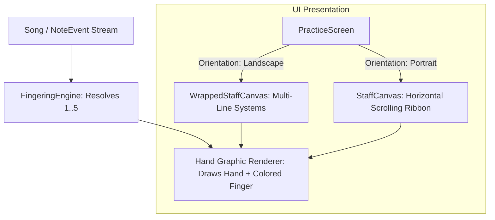

# Architecture & Technical Design: Hand Fingering & Wrapped Sheet Music

## 1. System Architecture

---

## 2. Component Specifications

### 2.1. `FingeringEngine` (`com.beginnerpiano.practice.FingeringEngine`)
- **Addresses**: `REQ-001`
- **Responsibilities**:
  - Checks if `note.fingerHint` is non-null and in range `1..5`.
  - Fallback logic for Right Hand C-Major 5-finger beginner drill:
    - MIDI 60 (C4) -> Finger 1 (Thumb)
    - MIDI 62 (D4) -> Finger 2 (Index)
    - MIDI 64 (E4) -> Finger 3 (Middle)
    - MIDI 65 (F4) -> Finger 4 (Ring)
    - MIDI 67 (G4) -> Finger 5 (Pinky)
    - Notes above G4 or below C4 mapped using nearest diatonic interval.

### 2.2. Hand Graphic Vector Renderer (`drawHandFingeringBadge`)
- **Addresses**: `REQ-002`
- **Location**: `com.beginnerpiano.ui.components.HandFingering`
- **Visual Structure**:
  - Draws palm base (soft rounded contour in neutral slate color).
  - Draws 5 individual finger paths/capsules (Thumb, Index, Middle, Ring, Pinky).
  - Inactive fingers are drawn in neutral outline/light slate fill.
  - Active target finger (1..5) is filled in its designated vibrant color:
    - 1: Blue (`#3B82F6`)
    - 2: Green (`#10B981`)
    - 3: Amber (`#F59E0B`)
    - 4: Orange (`#F97316`)
    - 5: Rose (`#EC4899`)
  - Accompanied by the finger digit text for extra clarity.

### 2.3. Wrapped Staff Canvas (`WrappedStaffCanvas`)
- **Addresses**: `REQ-003`
- **Layout Math**:
  - Given total canvas width $W$ and height $H$, computes optimal notes per row $N_{row}$ (typically 8 to 12 notes, or 2 to 4 measures per line).
  - Computes number of systems $S = \lceil \text{notes.size} / N_{row} \rceil$.
  - For each system $s \in [0, S)$:
    - Computes $Y_s$ center coordinate.
    - Draws 5 staff lines spanning left margin to right margin.
    - Draws Treble clef glyph at the start of each line.
    - Plots each note at $(X_{col}, Y_{note})$.
    - Active note gets a pulsing playhead glow or highlight box and the colored-finger hand badge.
    - Previous notes render with completed feedback colors; upcoming notes render crisp and readable.

### 2.4. Horizon Integration in `PracticeScreen.kt`
- **Addresses**: `REQ-004`
- **Logic**:
  - In `PracticeScreen.kt`, when `isLandscape == true`:
    - Substitute the scrolling `StaffCanvas` with `WrappedStaffCanvas`.
    - Automatically fit the song's systems into the landscape view with vertical scroll if a song is exceptionally long.
    - Keep top HUD and bottom piano keyboard accessible.
