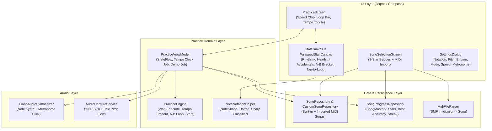

# Architecture Design: Pro Practice Suite

## 1. Architectural Overview
The Pro Practice Suite upgrades the `Beginner Piano` Android app across four layers: **Data & Persistence**, **Audio Synthesis**, **Practice Domain Engine**, and **Jetpack Compose UI**.

---

## 2. Component Design & Requirement Mapping

### 2.1 Rhythmic Notation & Sharp Accidental Classifier (`Addresses: REQ-005`)
- **File**: `app/src/main/java/com/beginnerpiano/ui/components/NoteNotationHelper.kt` [NEW]
- **Responsibilities**:
  - `enum class NoteHeadType { WHOLE, HALF, QUARTER, EIGHTH }`
  - `fun getNoteHeadType(durationBeats: Double): NoteHeadType`
  - `fun isDotted(durationBeats: Double): Boolean` (true when `abs(durationBeats - 1.5) < 0.12 || abs(durationBeats - 3.0) < 0.12`)
  - `fun isSharp(midiNote: Int): Boolean` (true when `(midiNote % 12) in setOf(1, 3, 6, 8, 10)`)
- **Canvas Rendering (`StaffCanvas.kt` & `WrappedStaffCanvas.kt`)**:
  - **Hollow Note Heads (`WHOLE`, `HALF`)**: Draw outer oval with `Stroke(width = 2.8.dp.toPx())` instead of solid fill; omit vertical stem for `WHOLE`.
  - **Eighth Note Flag (`EIGHTH`)**: Draw a curved bezier/line flag extending down-right from the top of the stem (`endX = stemX + 8.dp`, `endY = stemTopY + 12.dp`).
  - **Augmentation Dot (`isDotted`)**: Draw a filled circle (`radius = 2.5.dp.toPx()`) at `(noteX + 13.dp.toPx(), noteY - 2.dp.toPx())`.
  - **Sharp Symbol (`isSharp`)**: Draw `"♯"` via `nativeCanvas.drawText` at `(noteX - 15.dp.toPx(), noteY + 5.dp.toPx())` in `noteColor`.

### 2.2 Tempo Speed Multiplier & A–B Loop State Machine (`Addresses: REQ-006, REQ-007`)
- **File**: `app/src/main/java/com/beginnerpiano/practice/PracticeEngine.kt` [MODIFY]
- **Data Model Updates (`PracticeState`)**:
  - `tempoMultiplier: Float = 1.0f` (`effectiveBpm: Int` = `(song.defaultBpm * tempoMultiplier).toInt().coerceAtLeast(20)`)
  - `loopStartIndex: Int? = null`, `loopEndIndex: Int? = null` (`val isLoopActive: Boolean get() = loopStartIndex != null && loopEndIndex != null && loopStartIndex <= loopEndIndex`)
  - `metronomeEnabled: Boolean = true`
  - `isTempoRunning: Boolean = false`
  - `earnedStars: Int` computed from `accuracyPercent`: `>= 95 -> 3`, `>= 80 -> 2`, `>= 60 -> 1`, else `0`.
- **Engine Transitions**:
  - `setTempoMultiplier(multiplier: Float)`: Updates `tempoMultiplier` (`0.5f`, `0.75f`, `1.0f`, `1.25f`).
  - `setLoopRange(start: Int?, end: Int?)`: Clamps indices to `song.notes.indices`, orders `start <= end`, and if `currentNoteIndex !in start..end`, jumps `currentNoteIndex` to `start`.
  - `onNoteTappedForLoop(noteIndex: Int)`:
    - If no loop is set (`loopStartIndex == null`), sets `loopStartIndex = noteIndex, loopEndIndex = minOf(noteIndex + 3, song.notes.lastIndex)`.
    - If a loop is already active and `noteIndex > loopStartIndex`, updates `loopEndIndex = noteIndex`.
    - If `noteIndex < loopStartIndex`, updates `loopStartIndex = noteIndex`.
  - `clearLoop()`: Resets `loopStartIndex = null, loopEndIndex = null`.
  - **Loop Wrap-Around in `evaluateMidi` & `onBeatTimeout`**:
    - When `isLoopActive` is true and `currentNoteIndex` advances past `loopEndIndex`, `newIndex` wraps to `loopStartIndex` and `isCompleted` remains `false`.

### 2.3 Active Tempo Mode Clock & Metronome Click (`Addresses: REQ-008`)
- **Files**:
  - `app/src/main/java/com/beginnerpiano/audio/PianoAudioSynthesizer.kt` [MODIFY]
  - `app/src/main/java/com/beginnerpiano/practice/PracticeEngine.kt` [MODIFY]
  - `app/src/main/java/com/beginnerpiano/practice/PracticeViewModel.kt` [MODIFY]
- **Metronome Click Synthesis**:
  - `PianoAudioSynthesizer.playMetronomeClick(isDownbeat: Boolean = false)`: Generates a short (`25ms`) exponentially decaying woodblock/click buffer (`1200 Hz` on downbeat, `850 Hz` on normal beat blended with a crisp transient) so it sounds natural and finishes in `<30ms`.
- **Tempo Mode Coroutine Loop**:
  - In `PracticeViewModel`, when `mode == PracticeMode.TEMPO` and `isTempoRunning == true`, `tempoJob` steps through notes using `effectiveBpm`.
  - At the start of each note window, if `metronomeEnabled` is true, plays a metronome click.
  - Waits for `noteDurationMs = ((60_000.0 / effectiveBpm) * note.durationBeats).toLong().coerceAtLeast(200L)`.
  - If the user hits the target note during that window, `PracticeEngine` advances or marks the hit; if the window finishes and the note was not hit, `PracticeEngine.onBeatTimeout()` records a `MISMATCH` and advances to the next note (wrapping to `loopStartIndex` if A–B loop is active).

### 2.4 Persistent 3-Star Mastery & Custom MIDI Import (`Addresses: REQ-009`)
- **Files**:
  - `app/src/main/java/com/beginnerpiano/data/repository/SongProgressRepository.kt` [NEW]
  - `app/src/main/java/com/beginnerpiano/data/repository/CustomSongRepository.kt` [NEW]
  - `app/src/main/java/com/beginnerpiano/ui/screens/SongSelectionScreen.kt` [MODIFY]
  - `app/src/main/java/com/beginnerpiano/MainActivity.kt` [MODIFY]
- **`SongProgressRepository`**:
  - `data class SongMastery(val songId: String, val stars: Int, val bestAccuracy: Int, val bestStreak: Int, val playCount: Int)`
  - `fun recordCompletion(songId: String, accuracyPercent: Int, bestStreak: Int): SongMastery`
  - Persists JSON into `SharedPreferences("beginner_piano_progress")` when initialized with `Context`, and supports in-memory operation for unit tests.
- **`CustomSongRepository`**:
  - `fun importMidiStream(inputStream: InputStream, fallbackTitle: String? = null): Song`
  - Calls `MidiFileParser.parse(inputStream)`, constructs a `Song` with `DifficultyLevel` inferred from note range (`<= 5` semitones -> `BEGINNER`, `<= 12` -> `ELEMENTARY`, else `INTERMEDIATE`), persists the custom song list to `SharedPreferences("beginner_piano_custom_songs")`, and exposes `allSongs()` combining built-in `SongRepository.songs` + imported custom songs.
- **UI Integration**:
  - `SongSelectionScreen` header displays total stars earned (`⭐ X / Y`) and an **`+ Import MIDI`** button that launches the Android file picker (`ActivityResultContracts.GetContent()`).
  - Each `SongCard` displays a 3-star badge (`★★★`, `★★☆`, `★☆☆`, or `☆☆☆`) and best accuracy percentage when practiced.
  - `PracticeScreen` Completion Dialog displays the earned 1–3 stars (`⭐`) visually above Accuracy and Best Streak.
